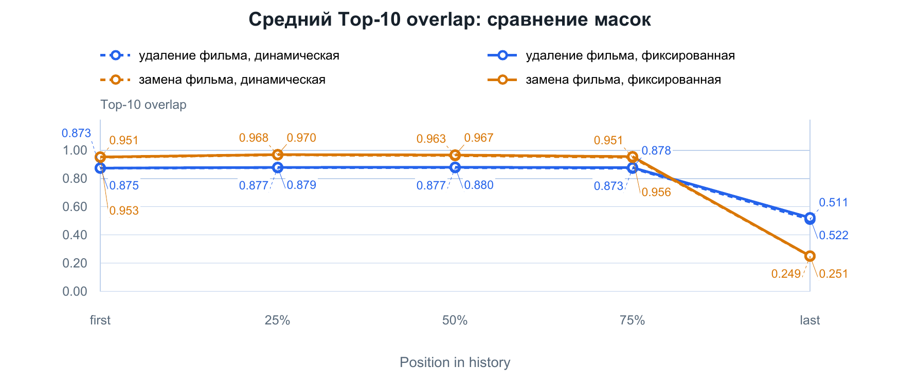
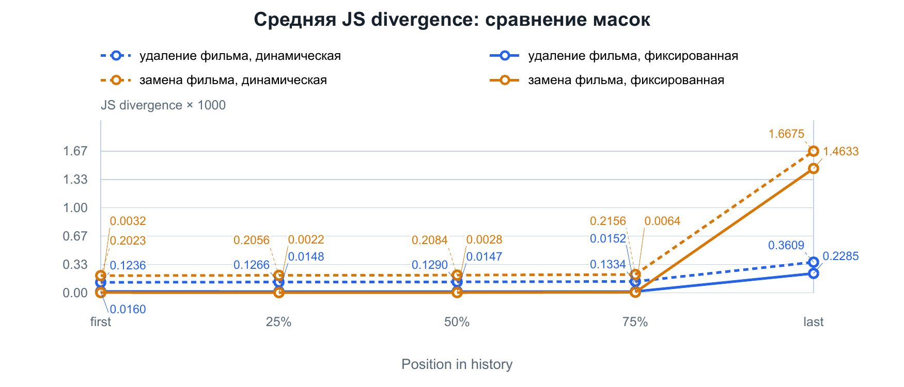
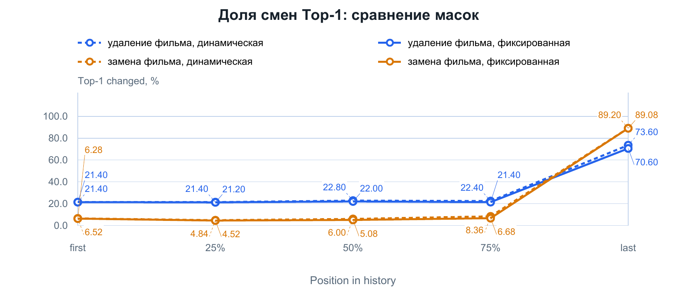
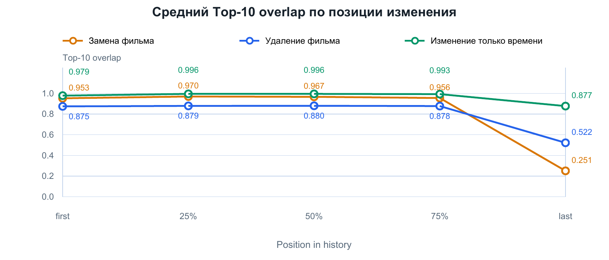
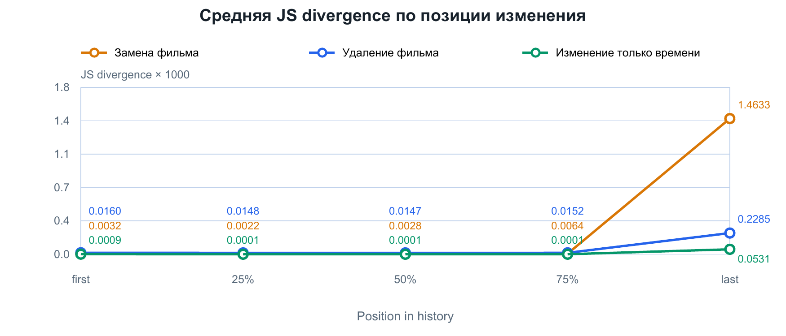
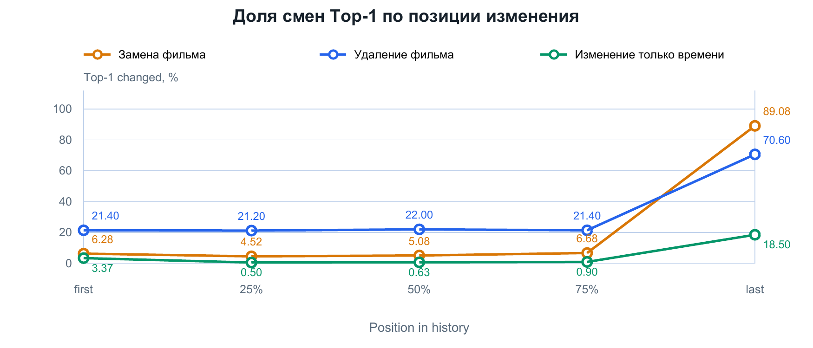
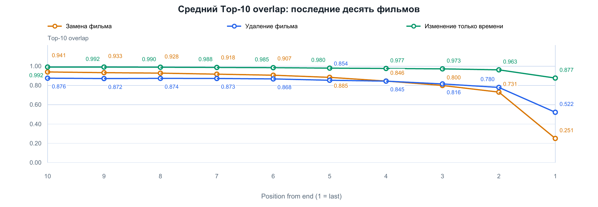
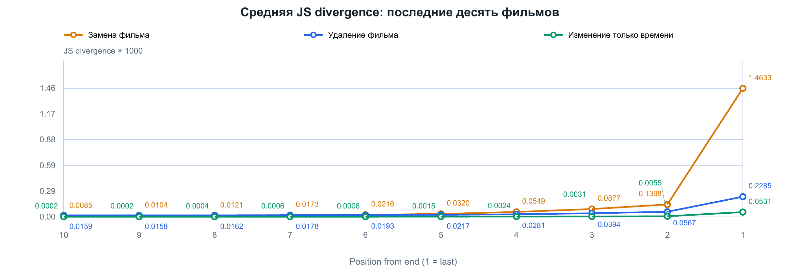
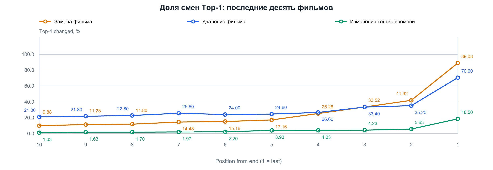

# Устойчивость рекомендаций HSTU: проверка причин чувствительности к последнему фильму
В первом эксперименте изменение последнего фильма существенно меняло рекомендации HSTU. 
На этом этапе проверяется, насколько наблюдаемый эффект связан с маскированием просмотренных фильмов и временными метками. 
Дополнительно исследуется чувствительность каждой из последних десяти позиций.

## Общие сведения и проверка корректности удаления

### Условия эксперимента

Используются те же данные MovieLens 1M, сохранённые параметры HSTU (`epoch_097.ckpt`), первые 500 пользователей test-набора и базовый seed `42`, что и на первом этапе. 

Метрики остаются прежними: Top-10 overlap, JS divergence и Top-1 changed.

### Проверка корректности возмущений

В эксперименте сохраняются архитектура, обученные параметры и логика вычислений модели. Все возмущения реализованы только через изменение входных данных.

При замене изменяется только идентификатор выбранного фильма. 
При удалении согласованно удаляются фильм и его временная метка, последующие элементы сдвигаются влево, фактическая длина уменьшается на единицу, а свободные позиции заполняются нулями. При изменении времени корректируется только временная метка с сохранением порядка событий. 

Модель изначально поддерживает истории разной длины в пределах настроенного максимума.
Например, история A → B передаётся как A, B, 0, …, 0 вместе с фактической длиной 2. Обработка padding нулевого дополнения предусмотрена в архитектуре самой модели: представления неиспользуемых позиций обнуляются, а переданная длина определяет реальную часть истории и выбор последнего состояния для предсказания. 
Поэтому после каждого возмущения достаточно согласованно сформировать вход и заново вызвать стандартную процедуру получения рекомендаций.


## 1. Влияние маскирования просмотренных фильмов

Перед выдачей рекомендаций мы исключаем фильмы, которые уже есть в истории пользователя. 
Если удалить или заменить фильм в истории, может измениться и список исключённых фильмов. 
Поэтому рекомендации могут измениться по двум причинам: модель получила другую историю, а некоторые фильмы стали доступны для рекомендации или, наоборот, были исключены. 
Чтобы разделить эти эффекты, сравниваем два варианта маскирования: динамический и фиксированный.

Рассмотрим замену последнего фильма:

```text
Исходная история:   A → B → C
Изменённая история: A → B → D
```

**Динамическая маска** строится по текущей истории. Для исходной истории исключены `A, B, C`, для изменённой - `A, B, D`. После замены фильм `C` становится допустимым, а `D` исключается.

**Фиксированная маска** строится по исходной истории и применяется к обеим историям. В обоих случаях исключены `A, B, C`. Поэтому множество допустимых рекомендаций сохраняется, хотя вход модели изменился.

При удалении действует то же правило: динамическая маска разрешает удалённый фильм, если он больше не встречается в истории, а фиксированная продолжает его исключать.

### Результаты




<!-- pagebreak -->







### Изменение последнего фильма

| Изменение | Маска | Top-10 overlap | JS × 1000 | Top-1 changed, % |
| --- | --- | ---: | ---: | ---: |
| Удаление | Динамическая | 0.5112 | 0.3609 | 73.60 |
| Удаление | Фиксированная | 0.5222 | 0.2285 | 70.60 |
| Замена | Динамическая | 0.2493 | 1.6675 | 89.20 |
| Замена | Фиксированная | 0.2506 | 1.4633 | 89.08 |
### Вывод
При фиксированной маске Top-10 overlap немного увеличивается, а доля смен первой рекомендации и JS divergence уменьшаются. 
Динамическая маска изменяет множество допустимых кандидатов, поэтому часть различий в выдаче возникает из-за разрешения и исключения фильмов. 
Однако сильная чувствительность к последнему фильму сохраняется: при его замене с фиксированной маской общими остаются около 25% рекомендаций, а первая рекомендация меняется примерно в 89% случаев. 

## 2. Влияние временных меток

Сравним, как меняются рекомендации в трёх случаях: при замене фильма, удалении фильма из истории и изменении только времени его просмотра. 

Рассмотрим историю A → B → C, где фильмы просмотрены в 10:00, 11:00 и 12:00 соответственно.
- **Замена фильма:** `(C, 12:00)` заменяется на `(D, 12:00)`. Время сохраняется.
- **Удаление фильма:** пара `(C, 12:00)` удаляется целиком; история становится короче.
- **Изменение только времени:** фильм `C` сохраняется, а его временная метка сдвигается.

Для времени используются шесть заданных сдвигов: ±1 час, ±1 день и ±7 дней. Для каждого пользователя и позиции сначала считаются метрики при каждом сдвиге, затем эти шесть значений усредняются. Полученное среднее усредняется по 500 пользователям.

Временная метка ограничивается соседними событиями, чтобы сохранить порядок просмотров; для последнего элемента верхняя граница - время правильного следующего фильма. Поэтому фактический сдвиг может быть меньше заданного или нулевым. Все такие случаи включены в среднее.

Во всех трёх вариантах используется фиксированная маска исходной истории. Графики показывают средние значения метрик для пяти исходных позиций.

### Сравнение трёх изменений



<!-- pagebreak -->





### Изменение последнего просмотра

| Воздействие       | Top-10 overlap | JS × 1000 | Top-1 changed, % |
|-------------------| ---: | ---: | ---: |
| Замена фильма     | 0.2506 | 1.4633 | 89.08 |
| Удаление фильма   | 0.5222 | 0.2285 | 70.60 |
| Изменение времени | 0.8774 | 0.0531 | 18.50 |

### Вывод
Изменение только времени в выбранном наборе сдвигов оказывает меньший средний эффект, чем замена фильма или удаление просмотра. Для последней позиции сохраняется около 88% Top-10, а первая рекомендация меняется в 18.5% случаев. Замена фильма даёт самый сильный эффект, удаление занимает промежуточное положение. 

<!-- pagebreak -->

## 3. Чувствительность последних десяти позиций

Чтобы подробнее изучить чувствительность модели в конце истории, поочерёдно изменяем каждый из последних десяти просмотров. Каждый раз берём исходную историю и изменяем только один просмотр. Позиции отсчитываются от конца: 1 — последний фильм, 2 — предпоследний, 10 — десятый от конца.

Для каждой позиции сравниваем три варианта: замену фильма с сохранением времени, удаление фильма вместе с его временной меткой и изменение только времени просмотра.

На графиках показаны средние значения метрик. Под каждым графиком приведена таблица: для каждой позиции жирным указано среднее по 500 пользователям, а под ним — границы 95%-го доверительного интервала в формате [нижняя граница; верхняя граница].

Интервалы рассчитаны методом bootstrap: из исходных 500 пользователей случайно выбирали 500 с возможностью повторения и заново вычисляли среднее. 
Эту процедуру повторили 5000 раз. Нижняя и верхняя границы интервала охватывают центральные 95% полученных средних.

### Top-10 overlap



**Таблица 1. Top-10 overlap: средние и 95%-е доверительные интервалы.**

| Позиция от конца | Замена фильма | Удаление фильма | Только время |
| ---: | --- | --- | --- |
| 10 | **0.9407**<br>[0.9357; 0.9458] | **0.8760**<br>[0.8662; 0.8858] | **0.9917**<br>[0.9898; 0.9935] |
| 9 | **0.9334**<br>[0.9284; 0.9386] | **0.8722**<br>[0.8622; 0.8824] | **0.9916**<br>[0.9895; 0.9935] |
| 8 | **0.9284**<br>[0.9224; 0.9341] | **0.8740**<br>[0.8640; 0.8840] | **0.9899**<br>[0.9876; 0.9919] |
| 7 | **0.9178**<br>[0.9117; 0.9236] | **0.8730**<br>[0.8630; 0.8832] | **0.9875**<br>[0.9850; 0.9900] |
| 6 | **0.9069**<br>[0.9005; 0.9134] | **0.8684**<br>[0.8582; 0.8786] | **0.9852**<br>[0.9827; 0.9877] |
| 5 | **0.8846**<br>[0.8774; 0.8915] | **0.8544**<br>[0.8436; 0.8646] | **0.9804**<br>[0.9767; 0.9837] |
| 4 | **0.8461**<br>[0.8364; 0.8550] | **0.8454**<br>[0.8344; 0.8562] | **0.9769**<br>[0.9732; 0.9804] |
| 3 | **0.8002**<br>[0.7888; 0.8113] | **0.8164**<br>[0.8040; 0.8288] | **0.9727**<br>[0.9689; 0.9763] |
| 2 | **0.7314**<br>[0.7176; 0.7447] | **0.7802**<br>[0.7664; 0.7940] | **0.9627**<br>[0.9574; 0.9677] |
| 1 | **0.2506**<br>[0.2369; 0.2646] | **0.5222**<br>[0.4994; 0.5444] | **0.8774**<br>[0.8648; 0.8902] |

<!-- pagebreak -->

### JS divergence



И средние, и границы интервалов в таблице умножены на 1000.

**Таблица 2. JS × 1000: средние и 95%-е доверительные интервалы.**

| Позиция от конца | Замена фильма | Удаление фильма | Только время |
| ---: | --- | --- | --- |
| 10 | **0.008542**<br>[0.007493; 0.009688] | **0.015924**<br>[0.014578; 0.017331] | **0.000223**<br>[0.000157; 0.000305] |
| 9 | **0.010380**<br>[0.009287; 0.011529] | **0.015844**<br>[0.014485; 0.017253] | **0.000223**<br>[0.000170; 0.000285] |
| 8 | **0.012101**<br>[0.010808; 0.013450] | **0.016168**<br>[0.014836; 0.017556] | **0.000425**<br>[0.000298; 0.000595] |
| 7 | **0.017317**<br>[0.015245; 0.019534] | **0.017794**<br>[0.016247; 0.019469] | **0.000631**<br>[0.000411; 0.000931] |
| 6 | **0.021587**<br>[0.018472; 0.026074] | **0.019263**<br>[0.017367; 0.021525] | **0.000802**<br>[0.000574; 0.001075] |
| 5 | **0.031964**<br>[0.028480; 0.035967] | **0.021748**<br>[0.020128; 0.023407] | **0.001480**<br>[0.001111; 0.001879] |
| 4 | **0.054861**<br>[0.048906; 0.061528] | **0.028078**<br>[0.025511; 0.030984] | **0.002438**<br>[0.001958; 0.002975] |
| 3 | **0.087688**<br>[0.079496; 0.096774] | **0.039352**<br>[0.035574; 0.043474] | **0.003131**<br>[0.002475; 0.003849] |
| 2 | **0.139841**<br>[0.129341; 0.151501] | **0.056690**<br>[0.051668; 0.062068] | **0.005529**<br>[0.004493; 0.006662] |
| 1 | **1.463314**<br>[1.358705; 1.570586] | **0.228489**<br>[0.209371; 0.248065] | **0.053143**<br>[0.044598; 0.061869] |

<!-- pagebreak -->

### Top-1 changed



И средние, и границы интервалов в таблице указаны в процентах.

**Таблица 3. Top-1 changed, %: средние и 95%-е доверительные интервалы.**

| Позиция от конца | Замена фильма | Удаление фильма | Только время |
| ---: | --- | --- | --- |
| 10 | **9.88**<br>[8.04; 11.84] | **21.00**<br>[17.60; 24.60] | **1.03**<br>[0.40; 1.83] |
| 9 | **11.28**<br>[9.28; 13.36] | **21.80**<br>[18.40; 25.60] | **1.63**<br>[0.83; 2.60] |
| 8 | **11.80**<br>[9.80; 13.92] | **22.80**<br>[19.20; 26.60] | **1.70**<br>[1.00; 2.60] |
| 7 | **14.48**<br>[12.24; 16.88] | **25.60**<br>[21.80; 29.40] | **1.97**<br>[1.17; 2.87] |
| 6 | **15.16**<br>[12.92; 17.48] | **24.00**<br>[20.40; 27.80] | **2.20**<br>[1.30; 3.20] |
| 5 | **17.16**<br>[14.68; 19.68] | **24.60**<br>[21.00; 28.40] | **3.93**<br>[2.73; 5.23] |
| 4 | **25.28**<br>[22.44; 28.04] | **26.60**<br>[22.80; 30.40] | **4.03**<br>[2.90; 5.20] |
| 3 | **33.52**<br>[30.48; 36.68] | **33.40**<br>[29.20; 37.60] | **4.23**<br>[3.07; 5.50] |
| 2 | **41.92**<br>[38.68; 45.16] | **35.20**<br>[31.00; 39.40] | **5.63**<br>[4.30; 7.03] |
| 1 | **89.08**<br>[87.40; 90.68] | **70.60**<br>[66.40; 74.60] | **18.50**<br>[16.13; 20.87] |

### Вывод

Изменение последнего фильма влияет на рекомендации заметно сильнее, чем изменение предпоследнего. При замене фильма Top-10 overlap снижается с 0.7314 для предпоследней позиции до 0.2506 для последней. При удалении — с 0.7802 до 0.5222. Это означает, что после изменения последнего фильма в рекомендациях сохраняется значительно меньше фильмов из исходного Top-10. Также увеличивается JS divergence и чаще меняется первая рекомендация.
## Общий вывод
Сильная чувствительность к последнему фильму сохраняется при фиксированном множестве кандидатов и неизменных временных метках. 
Изменение маски влияет на метрики, но не устраняет наблюдаемый эффект. 
Выбранные временные возмущения в среднем дают меньший эффект, а между предпоследней и последней позициями ярко выражен скачок метрик. 
